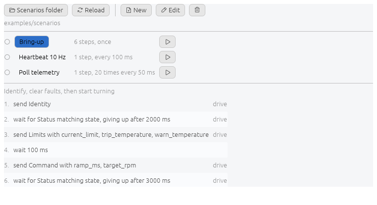

# Scenarios

A scenario is an ordered list of steps run against one or more connections.



## Running

Pick one and press play. The row shows the current step and pass. Play becomes
stop.

A scenario that names a connection the project does not have reports it and does
not start.

## From the command line

The terminal front end's `--run` runs one scenario with no screen, printing
what happens and exiting once it ends:

```sh
protocol-simulator-tui project.toml --run "Heartbeat 10 Hz"
```

Connections marked autoconnect are opened first. The exit code is 0 once the
scenario completed, 1 for anything else, including a name `--run` does not
find. A scenario with no `times` runs until the process is stopped, which for
a service started at boot is `SIGTERM`, the same as any other.

`--control-port PORT`, given alongside `--run`, opens a local TCP socket for
an external script: one JSON request per line in, one JSON response per line
out.

```
{"cmd":"set","step":2,"field":"speed","value":42}
-> {"ok":true}  |  {"ok":false,"error":"..."}

{"cmd":"last_received","on":"drive","as":"Telemetry"}
-> {"ok":true,"bytes":"AA 55 ...","fields":{"speed":42,"mode":1},"kinds":{"speed":"u16","mode":"enum"},"field_order":["speed","mode"]}
-> {"ok":false,"error":"nothing received yet on drive"}

{"cmd":"last_sent","on":"drive","as":"Telemetry"}
-> {"ok":true,"bytes":"AA 55 ...","fields":{"speed":42,"mode":1},"kinds":{"speed":"u16","mode":"enum"},"field_order":["speed","mode"]}
-> {"ok":false,"error":"nothing sent yet on drive"}
```

`step` counts from one, as the row above it in this page already does. Every
field declared by a `send` step's frame can be changed live, whether it uses a
frame default or is listed in `with`. A request naming another step or field
returns `ok: false` with an error instead of being silently ignored.

`last_received` and `last_sent` decode the most recent frame in each direction
on a connection. `as` selects the frame definition to use for decoding, and
`kinds` maps each decoded field name to its declared type. `field_order` lists
the fields in their declaration order, for clients that display them.
Bitfield values are represented as their packed decimal integer; `set` accepts
that same unsigned decimal value for a bitfield.

## Steps

| Step | Key | Carries |
| --- | --- | --- |
| send a frame | `send` | `with`, values overriding the defaults, `counters`, and `from_capture` |
| send raw bytes | `raw` | a hex string |
| wait | `wait_ms` | a delay in milliseconds |
| wait for | `wait_for` | a frame, its expected values and what to capture, or a hex pattern, plus `timeout_ms` |

`wait_for` takes one of two shapes:

```toml
wait_for = { frame = "Status", match = { state = 2 }, timeout_ms = 500 }
wait_for = { hex = "AA 55 ?? 01", at = 0, timeout_ms = 500 }
```

By default, a timeout stops the scenario. A repeating scenario can log a
timeout and start its next pass instead:

```toml
wait_for = { frame = "Status", match = { state = 2 }, timeout_ms = 500, on_timeout = "continue" }
```

Naming a frame is resolved against the definition when the scenario starts, so
editing the frame afterwards leaves the wait meaning the same thing. Fields left
out of `match` are unconstrained. `??` in a hex pattern matches any byte, and
`at` pins it to a byte offset. The two shapes are exclusive, and a wait needs
one of them.

## Captures

A field a `wait_for` reads back can be remembered under a name of its own, for
a later step to send on, on any connection.

```toml
[[scenario.step]]
send = "Request"
on = "server1"

[[scenario.step]]
wait_for = { frame = "Response", capture = { code = "server1_code" } }
on = "server1"

[[scenario.step]]
send = "Forward"
on = "server2"
from_capture = { payload = "server1_code" }
```

`capture` names, on the left, a field of the frame being waited for. On the
right is the variable it becomes. `from_capture` on a later `send` step names,
on the left, one of that frame's own fields, filled with whatever the variable
on the right last held.

A capture needs a frame to decode by, so it is refused on a hex pattern wait.
It also needs one target, an answer from a second one having nothing to do
with the first. `from_capture` is refused where it names a variable no earlier
step captures, caught when the scenario loads rather than partway through a
run. A variable is remembered for one pass and is gone before the next repeat
starts, so a step reading it always reads what this pass captured.

## Correlating a reply to a request

A `send` can remember a field after all of its values, captures, live
overrides, and counters have been resolved. A later frame wait can match a
field against that remembered value. This is useful for request IDs:

```toml
[[scenario.step]]
send = "Request"
counters = { id = { wrap = 65535 } }
capture = { id = "request_id" }

[[scenario.step]]
wait_for = { frame = "Response", match_from_capture = { id = "request_id" }, timeout_ms = 500 }
```

`match` and `match_from_capture` may name different fields in the same wait,
but never the same field. The variable must have been captured by an earlier
`send` or `wait_for` step. As with other captures, it exists for one pass only.

## Rules

A rule reads what an earlier step sent or received in the current pass and
decides what a later `send` carries. It covers what a capture cannot say: send
a field only if a bit came back set, fill one bit from another, keep part of a
received value.

```toml
[[scenario.rule]]
name = "mirror fault"
when = { all = [
  { step = 2, field = "status", bit = "fault", equals = 1 },
  { step = 2, field = "status", bit = "busy", equals = 0 },
] }
set = { step = 4, field = "flags", bit = "alarm", from = { step = 2, field = "status", bit = "fault" } }

[[scenario.rule]]
set = { step = 4, field = "speed", from = { step = 2, field = "raw" }, and = 0x0F, or = 0x80 }
```

Steps are numbered from one, as in error messages.

| Key | Meaning |
| --- | --- |
| `name` | Optional. Used in error messages in place of the rule's number |
| `when` | Optional. Without it the rule always applies |
| `when.all` | Every test must hold |
| `when.any` | At least one test must hold |
| test | `{ step, field, bit, equals }`. `bit` is optional and reads one bit of a bitfield |
| `set.step`, `set.field` | The `send` step and the field to write |
| `set.bit` | Optional. Writes one bit of a bitfield and leaves the others as they were |
| `set.from` | `{ step, field, bit }`, the value to copy. `bit` is optional |
| `set.value` | A fixed value, instead of `from` |
| `set.and`, `set.or` | Optional masks on what `from` read. The result is `(read AND and) OR or` |

`when` takes either `all` or `any`, never both. `set` takes either `from` or
`value`, never both, and the masks go with `from` only.

Rules apply in the order the file lists them. Two rules on the same field are
how two conditions pick between two values, the last one that holds wins. Two
rules on different bits of one field both land.

A bit that no rule sets keeps the step's own value, or the frame's default when
the step sets nothing. A rule whose condition does not hold changes nothing.

Numbers compare as numbers, so `equals = 2` matches a signed or an unsigned 2.
An enum is compared by its number, not its variant name.

Checked when the scenario loads:

| Refused | Because |
| --- | --- |
| A step that does not exist | Nothing to read or write |
| A target step that is not a `send` | Only a sent frame has fields to fill |
| A source step that does not come before the target | It has not run yet |
| A source step that is a delay, a raw send or a hex pattern wait | It has no named fields |
| A source `wait_for` aimed at several links | Several answers, only one would be kept |
| A target field that the step sets in `with`, `counters` or `from_capture` | Two sources would fight over it |
| Both or neither of `all` and `any`, or an empty list | The condition says nothing |
| Both or neither of `from` and `value`, or a mask next to `value` | The rule sets nothing, or two things |

Checked when the step runs, because it needs the frame definitions:

| Failure | Because |
| --- | --- |
| A field or a bit the frame does not have | Named in the message |
| A `bit` on a field that is not a bitfield | Named in the message |
| A mask on a value that is not an unsigned number | There are no bits to mask |
| A value no earlier step produced | A source frame that did not decode, or a field it lacks |

A failing rule fails the step and the scenario, with the rule and what it could
not read. A rule's values are remembered for one pass, as captures are.

A live override of a field a rule writes is replaced by the rule on the next
send.

## Targets

`on` at the scenario level applies to every step. A step may carry its own `on`
to override it. A `wait_ms` step has no targets.

```toml
on = "drive"
on = ["drive", "gateway"]
```

## Repeats

```toml
repeat = { every_ms = 100 }             # until stopped
repeat = { every_ms = 100, times = 10 } # ten passes
```

The period is the interval between starts. A pass that overruns does not queue a
catch up burst, the next tick is skipped.

## Counters

A counter replaces a field value with one that steps every pass.

```toml
counters = { seq = { wrap = 255 } }
counters = { "head.seq" = { from = 1, step = 2, wrap = 255 } }
```

`from` defaults to 0, `step` to 1. `wrap` is inclusive, so a byte counter comes
back to `from` after 255. The editor offers a fixed value or a counter for a
field, not both.

## Editing

New and Edit open the step editor. Connections are checkboxes, frames and field
names come from what is loaded, and values use the same widgets as the Frames
panel.

Save is refused when the result could not be read back, with the reason shown.
An empty name, a step with no bytes, a wait matching on nothing, a scenario with
no steps.

## File format

Several scenarios to a file, in a folder of your choosing.

```toml
[[scenario]]
name = "Heartbeat 10 Hz"
description = "Keeps the drive from timing out"
on = "drive"
repeat = { every_ms = 100 }

[[scenario.step]]
send = "Heartbeat"
counters = { seq = { wrap = 255 } }
```

Two worked examples ship in [`examples/scenarios`](../examples/scenarios).
Saving from the app rewrites the origin file and leaves its comments alone.
